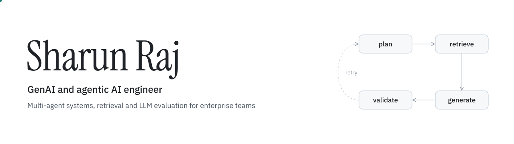

<picture>
  <source media="(prefers-color-scheme: dark)" srcset="assets/hero-dark.svg">
  
</picture>

I build multi-agent systems and LLM applications for enterprise teams. Recent work includes agents that triage test failures, answer finance questions in plain English, and write the SQL behind ETL pipelines, along with the evaluation and guardrails that keep them reliable in production.

You can reach me on [LinkedIn](https://www.linkedin.com/in/sharun-raj-nambayil-93a46219a/) or at [sharunraj39@gmail.com](mailto:sharunraj39@gmail.com).

## Selected work

| Project | What it does | Outcome |
| --- | --- | --- |
| **Test log triage** | Categorizes test failures, finds root causes and files Jira defects, using agentic RAG over FAISS and BM25 hybrid search | Triage 90% faster |
| **Self-healing AIOps** | Detects incidents, runs remediation and streams status to ServiceNow in real time | MTTR down 70%+ |
| **Financial analytics agents** | Planner, schema, SQL, validation and visualization agents let finance teams query GL, AP/AR and KPIs in plain English | Response latency down 41% |
| **LLM governance and observability** | Tracks tokens, cost, latency and usage across LLM apps, with PII, toxicity, prompt-injection and faithfulness checks | |
| **Agentic SQL generation** | Reads source-to-target mappings from Jira and writes optimized ETL SQL with self-learning YAML skills, then delivers it to GitHub | |
| **Log anomaly detection** | Processes operational logs through a Databricks medallion architecture to surface anomalies | |

## Stack

| Area | Tools |
| --- | --- |
| Agents and LLMs | LangGraph, LangChain, MCP, tool calling, Azure OpenAI, Claude, Gemini, OpenSpec |
| Retrieval | FAISS, BM25, hybrid and semantic search, Neo4j, semantic caching |
| Evaluation and safety | LLM-as-a-judge, faithfulness and grounding checks, Presidio, guardrails, observability |
| Backend and apps | Python, FastAPI, Flask, WebSockets, Next.js, React, Streamlit, Gradio |
| Data | SQL, PostgreSQL, Redis, MySQL, MongoDB, Databricks, Airflow, Prefect |
| Cloud and tooling | Azure, AWS, Docker, GitHub, Jira, ServiceNow |
| Also | OpenCV, scikit-learn, Figma |

## Publication

**Multimodal deepfake detection using deep convolutional neural networks and mel-frequency cepstral coefficients.** IEEE, 2024. [Code](https://github.com/sharunraj/Multimodal-Deepfake-Detection)
