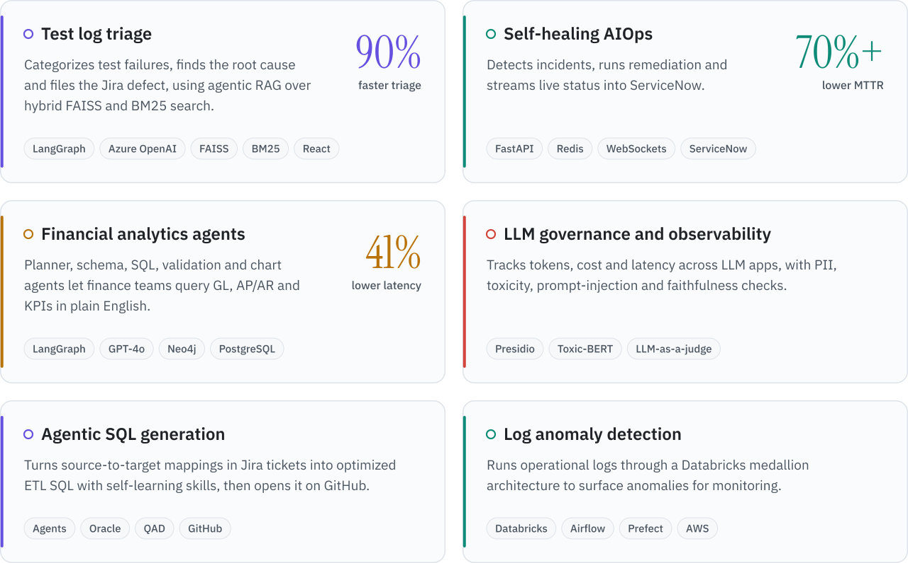

<picture>
  <source media="(prefers-color-scheme: dark)" srcset="assets/hero-dark.svg">
  
</picture>

I build multi-agent systems and LLM applications for enterprise teams. Recent work includes agents that triage test failures, answer finance questions in plain English, and write the SQL behind ETL pipelines, along with the evaluation and guardrails that keep them reliable in production.

You can reach me on [LinkedIn](https://www.linkedin.com/in/sharun-raj-nambayil-93a46219a/) or at [sharunraj39@gmail.com](mailto:sharunraj39@gmail.com).

## Selected work

<picture>
  <source media="(prefers-color-scheme: dark)" srcset="assets/work-dark.svg">
  
</picture>

## Stack

<picture>
  <source media="(prefers-color-scheme: dark)" srcset="assets/stack-dark.svg">
  
</picture>

## Publication

**Multimodal deepfake detection using deep convolutional neural networks and mel-frequency cepstral coefficients.** IEEE, 2024. [Code](https://github.com/sharunraj/Multimodal-Deepfake-Detection)
